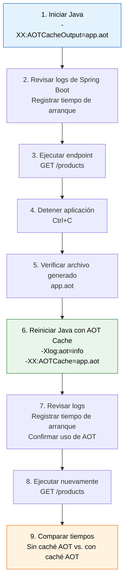

## AOT Cache

Para este laboratorio, realizaremos las siguiente secuencia de pasos, al igual que para la validación de la compilación y ejecución, requeriremos 2 ventanas, una para ejecutar y otra para invocar.

Estos son los pasos.



### Primero generemos el caché
Tanto en linux como en windows:

```shell
java -XX:AOTCacheOutput=app.aot -jar target/jep-483-lab-1.0.0.jar 
```

Salida:

```shell
  .   ____          _            __ _ _
 /\\ / ___'_ __ _ _(_)_ __  __ _ \ \ \ \
( ( )\___ | '_ | '_| | '_ \/ _` | \ \ \ \
 \\/  ___)| |_)| | | | | || (_| |  ) ) ) )
  '  |____| .__|_| |_|_| |_\__, | / / / /
 =========|_|==============|___/=/_/_/_/

 :: Spring Boot ::                (v3.5.4)

2026-10-25T07:14:53.258-06:00  INFO 22700 --- [jep-483-lab] [           main] dev.rugi.aot.AotApplication              : Starting AotApplication v1.0.0 using Java 25 with PID 22700 (D:\code\github\javaAlDia\javaAldia\code\jep-483-aot-class-loading-lab\target\jep-483-lab-1.0.0.jar started by admin in D:\code\github\javaAlDia\javaAldia\code\jep-483-aot-class-loading-lab)
2026-10-25T07:14:53.261-06:00  INFO 22700 --- [jep-483-lab] [           main] dev.rugi.aot.AotApplication              : No active profile set, falling back to 1 default profile: "default"
2026-10-25T07:14:54.222-06:00  INFO 22700 --- [jep-483-lab] [           main] o.s.b.w.embedded.tomcat.TomcatWebServer  : Tomcat initialized with port 8383 (http)
2026-10-25T07:14:54.238-06:00  INFO 22700 --- [jep-483-lab] [           main] o.apache.catalina.core.StandardService   : Starting service [Tomcat]
2026-10-25T07:14:54.238-06:00  INFO 22700 --- [jep-483-lab] [           main] o.apache.catalina.core.StandardEngine    : Starting Servlet engine: [Apache Tomcat/10.1.43]
2026-10-25T07:14:54.283-06:00  INFO 22700 --- [jep-483-lab] [           main] o.a.c.c.C.[Tomcat].[localhost].[/]       : Initializing Spring embedded WebApplicationContext
2026-10-25T07:14:54.284-06:00  INFO 22700 --- [jep-483-lab] [           main] w.s.c.ServletWebServerApplicationContext : Root WebApplicationContext: initialization completed in 964 ms
2026-10-25T07:14:54.736-06:00  INFO 22700 --- [jep-483-lab] [           main] o.s.b.w.embedded.tomcat.TomcatWebServer  : Tomcat started on port 8383 (http) with context path '/'
2026-10-25T07:14:54.795-06:00  INFO 22700 --- [jep-483-lab] [           main] dev.rugi.aot.AotApplication              : Started AotApplication in 1.93 seconds (process running for 2.667)
```

En otra ventana ejecutamos:

Linux:

``` shell
curl http://localhost:8383/products
```

Windows:

```shell
curl.exe http://localhost:8383/products
```

En ambos casos veremos como salida:

```json
[{"id":1,"name":"Laptop","price":15000.00},{"id":2,"name":"Monitor","price":4500.00},{"id":3,"name":"Keyboard","price":1200.00}]
```

### Validar generacion de archivo aot.

Ahora detenemos la ejecución (CTRL+C) y veremos un archivo llamado:

```shell
 app.aot
```

### Ejecutar con aot

Ahora, ejecutaremos pero, usando el archivo aot que recién generamos:

```shell
java -Xlog:aot=info -XX:AOTCache=app.aot -jar target/jep-483-lab-1.0.0.jar
```

Dado que usamos la opcion, 

```shell
-Xlog:aot=info 
```

veremos los logs relacionados con aot:

```shell
[0.013s][info][aot] trying to map app.aot
[0.013s][info][aot] Opened AOT cache app.aot.
[0.013s][info][aot] The AOT cache was created with UseCompressedOops = 1, UseCompressedClassPointers = 1, UseCompactObjectHeaders = 0
[0.014s][info][aot] Core region alignment: 65536
[0.014s][info][aot] ArchiveRelocationMode: 1
[0.014s][info][aot] ArchiveRelocationMode == 1: always map archive(s) at an alternative address
[0.014s][info][aot] Try to map archive(s) at an alternative address
[0.014s][info][aot] Reserved archive_space_rs [0x0000000013000000 - 0x0000000017000000] (67108864) bytes (includes protection zone)
[0.014s][info][aot] Reserved class_space_rs   [0x0000000017000000 - 0x0000000057000000] (1073741824) bytes
[0.015s][info][aot] Commit static  region #0 at base 0x0000000013010000 top 0x00000000143d0000 (ReadWrite)
[0.023s][info][aot] Mapped static  region #0 at base 0x0000000013010000 top 0x00000000143d0000 (ReadWrite)
[0.023s][info][aot] Commit static  region #1 at base 0x00000000143d0000 top 0x00000000160c0000 (ReadOnly)
[0.037s][info][aot] Mapped static  region #1 at base 0x00000000143d0000 top 0x00000000160c0000 (ReadOnly)
[0.037s][info][aot] Mapped static  region #2 at base 0x000001795f2e0000 top 0x000001795f390000 (Bitmap)
[0.042s][info][aot] archived module property jdk.module.main: (null)
[0.042s][info][aot] archived module property jdk.module.addexports: (null)
[0.042s][info][aot] archived module property jdk.module.addmods: (null)
[0.042s][info][aot] archived module property jdk.module.enable.native.access: (null)
[0.043s][info][aot] archived module property jdk.module.addopens: (null)
[0.043s][info][aot] archived module property jdk.module.addreads: (null)
[0.043s][info][aot] optimized module handling: enabled
[0.043s][info][aot] full module graph: enabled
[0.043s][info][aot] CDS archive was created with max heap size = 16328M, and the following configuration:
[0.044s][info][aot]     narrow_klass_base at mapping start address, narrow_klass_pointer_bits = 32, narrow_klass_shift = 0
[0.044s][info][aot]     narrow_oop_mode = 1, narrow_oop_base = 0x0000000000000000, narrow_oop_shift = 3
[0.044s][info][aot] The current max heap size = 16328M, G1HeapRegion::GrainBytes = 8388608
[0.044s][info][aot]     narrow_klass_base = 0x0000000013000000, arrow_klass_pointer_bits = 32, narrow_klass_shift = 0
[0.044s][info][aot]     narrow_oop_mode = 1, narrow_oop_base = 0x0000000000000000, narrow_oop_shift = 3
[0.045s][info][aot]     heap range = [0x0000000403800000 - 0x0000000800000000]
[0.045s][info][aot] Preferred address to map heap data (to avoid relocation) is 0x00000007ff800000
[0.045s][info][aot] Commit static  region #3 at base 0x00000007ff800000 top 0x00000007ff944000 (Heap)
[0.046s][info][aot] Heap data mapped at 0x00000007ff800000, size =  1323152 bytes
[0.046s][info][aot] CDS heap data relocation delta = 0 bytes
[0.046s][info][aot] initial optimized module handling: enabled
[0.046s][info][aot] initial full module graph: enabled
[0.046s][info][aot] use_full_module_graph = true; java.base = 0x00000000143bd798
[0.047s][info][aot] Commit static  region #4 at base 0x000001795f390000 top 0x000001795f410000 (Code)
[0.047s][info][aot] Mapped static  region #4 at base 0x000001795f390000 top 0x000001795f410000 (Code)
[0.047s][info][aot] Unmapping region #2 at base 0x000001795f2e0000 (Bitmap)
[0.048s][info][aot] Using AOT-linked classes: true (static archive: has aot-linked classes)

  .   ____          _            __ _ _
 /\\ / ___'_ __ _ _(_)_ __  __ _ \ \ \ \
( ( )\___ | '_ | '_| | '_ \/ _` | \ \ \ \
 \\/  ___)| |_)| | | | | || (_| |  ) ) ) )
  '  |____| .__|_| |_|_| |_\__, | / / / /
 =========|_|==============|___/=/_/_/_/

 :: Spring Boot ::                (v3.5.4)

2026-10-25T07:21:42.817-06:00  INFO 51684 --- [jep-483-lab] [           main] dev.rugi.aot.AotApplication              : Starting AotApplication v1.0.0 using Java 25 with PID 51684 (D:\code\github\javaAlDia\javaAldia\code\jep-483-aot-class-loading-lab\target\jep-483-lab-1.0.0.jar started by admin in D:\code\github\javaAlDia\javaAldia\code\jep-483-aot-class-loading-lab)
2026-10-25T07:21:42.820-06:00  INFO 51684 --- [jep-483-lab] [           main] dev.rugi.aot.AotApplication              : No active profile set, falling back to 1 default profile: "default"
2026-10-25T07:21:43.351-06:00  INFO 51684 --- [jep-483-lab] [           main] o.s.b.w.embedded.tomcat.TomcatWebServer  : Tomcat initialized with port 8383 (http)
2026-10-25T07:21:43.360-06:00  INFO 51684 --- [jep-483-lab] [           main] o.apache.catalina.core.StandardService   : Starting service [Tomcat]
2026-10-25T07:21:43.360-06:00  INFO 51684 --- [jep-483-lab] [           main] o.apache.catalina.core.StandardEngine    : Starting Servlet engine: [Apache Tomcat/10.1.43]
2026-10-25T07:21:43.384-06:00  INFO 51684 --- [jep-483-lab] [           main] o.a.c.c.C.[Tomcat].[localhost].[/]       : Initializing Spring embedded WebApplicationContext
2026-10-25T07:21:43.384-06:00  INFO 51684 --- [jep-483-lab] [           main] w.s.c.ServletWebServerApplicationContext : Root WebApplicationContext: initialization completed in 526 ms
2026-10-25T07:21:43.592-06:00  INFO 51684 --- [jep-483-lab] [           main] o.s.b.w.embedded.tomcat.TomcatWebServer  : Tomcat started on port 8383 (http) with context path '/'
2026-10-25T07:21:43.600-06:00  INFO 51684 --- [jep-483-lab] [           main] dev.rugi.aot.AotApplication              : Started AotApplication in 1.037 seconds (process running for 1.376)

```

Debemos prestar especial atención a los siguientes:


```
[0.013s][info][aot] Opened AOT cache app.aot.
[0.048s][info][aot] Using AOT-linked classes: true (static archive: has aot-linked classes)
```
Eso nos indica cual archivo estamos uasndo y si se logró cargar adecuadamente.


Revisemos tambien los tiempos

```shell 
2026-10-25T07:21:43.592-06:00  INFO 51684 --- [jep-483-lab] [           main] o.s.b.w.embedded.tomcat.TomcatWebServer  : Tomcat started on port 8383 (http) with context path '/'
2026-10-25T07:21:43.600-06:00  INFO 51684 --- [jep-483-lab] [           main] dev.rugi.aot.AotApplication              : Started AotApplication in 1.037 seconds (process running for 1.376)
```
Hemos pasado de:

Sin aot:
```
Started AotApplication in 1.93 seconds (process running for 2.667)
```

Con aot:

```
: Started AotApplication in 1.037 seconds (process running for 1.376)
```

Ahi está la mágia.  :)


### Cleanup
En caso de que quieras realizar la prueba varias veces, sólo debes elimimar los archivos generados:

Linux:
```shell
rm -f app.aot app.aot.config
```


power shell:
```shell
del app.aot app.aot.config
```
