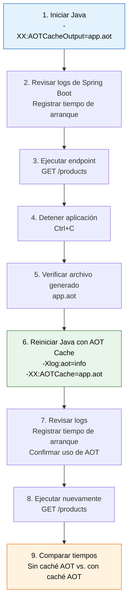

## AOT Cache

Para este laboratorio, realizaremos las siguiente secuencia de pasos, al igual que para la validación de la compilación y ejecución, requeriremos 2 ventanas, una para ejecutar y otra para invocar.

Estos son los pasos.



### Primero generemos el caché
Tanto en linux como en windows:

```shell
java -XX:AOTCacheOutput=app.aot -jar target/jep-483-lab-1.0.0.jar 
```

Salida:

```shell
  .   ____          _            __ _ _
 /\\ / ___'_ __ _ _(_)_ __  __ _ \ \ \ \
( ( )\___ | '_ | '_| | '_ \/ _` | \ \ \ \
 \\/  ___)| |_)| | | | | || (_| |  ) ) ) )
  '  |____| .__|_| |_|_| |_\__, | / / / /
 =========|_|==============|___/=/_/_/_/

 :: Spring Boot ::                (v3.5.4)

2026-10-25T07:14:53.258-06:00  INFO 22700 --- [jep-483-lab] [           main] dev.rugi.aot.AotApplication              : Starting AotApplication v1.0.0 using Java 25 with PID 22700 (D:\code\github\javaAlDia\javaAldia\code\jep-483-aot-class-loading-lab\target\jep-483-lab-1.0.0.jar started by admin in D:\code\github\javaAlDia\javaAldia\code\jep-483-aot-class-loading-lab)
2026-10-25T07:14:53.261-06:00  INFO 22700 --- [jep-483-lab] [           main] dev.rugi.aot.AotApplication              : No active profile set, falling back to 1 default profile: "default"
2026-10-25T07:14:54.222-06:00  INFO 22700 --- [jep-483-lab] [           main] o.s.b.w.embedded.tomcat.TomcatWebServer  : Tomcat initialized with port 8383 (http)
2026-10-25T07:14:54.238-06:00  INFO 22700 --- [jep-483-lab] [           main] o.apache.catalina.core.StandardService   : Starting service [Tomcat]
2026-10-25T07:14:54.238-06:00  INFO 22700 --- [jep-483-lab] [           main] o.apache.catalina.core.StandardEngine    : Starting Servlet engine: [Apache Tomcat/10.1.43]
2026-10-25T07:14:54.283-06:00  INFO 22700 --- [jep-483-lab] [           main] o.a.c.c.C.[Tomcat].[localhost].[/]       : Initializing Spring embedded WebApplicationContext
2026-10-25T07:14:54.284-06:00  INFO 22700 --- [jep-483-lab] [           main] w.s.c.ServletWebServerApplicationContext : Root WebApplicationContext: initialization completed in 964 ms
2026-10-25T07:14:54.736-06:00  INFO 22700 --- [jep-483-lab] [           main] o.s.b.w.embedded.tomcat.TomcatWebServer  : Tomcat started on port 8383 (http) with context path '/'
2026-10-25T07:14:54.795-06:00  INFO 22700 --- [jep-483-lab] [           main] dev.rugi.aot.AotApplication              : Started AotApplication in 1.93 seconds (process running for 2.667)
```

En otra ventana ejecutamos:

Linux:

``` shell
curl http://localhost:8383/products
```

Windows:

```shell
curl.exe http://localhost:8383/products
```

En ambos casos veremos como salida:

```json
[{"id":1,"name":"Laptop","price":15000.00},{"id":2,"name":"Monitor","price":4500.00},{"id":3,"name":"Keyboard","price":1200.00}]
```


### Cleanup
En caso de que quieras realizar la prueba varias veces, sólo debes elimimar los archivos generados:

Linux:
```shell
rm -f app.aot app.aot.config
```


power shell:
```shell
del app.aot app.aot.config
```
